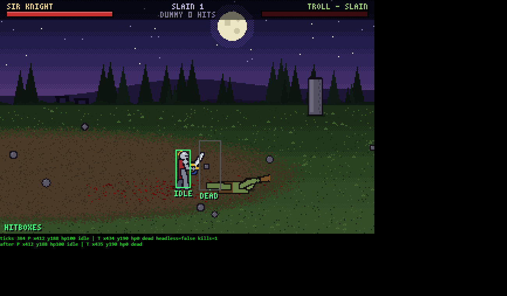

# Moonstone combat prototype — notes

A prototype of the side-view combat from *Moonstone: A Hard Days Knight* (Rob Anderson / Mindscape, Amiga 1991).
Plain HTML + JavaScript canvas. No build step, no dependencies, no server: open `index.html` in a browser.



## Status (2026-10-21)

Working:
- Arena with a depth plane (move left/right **and** up/down, Golden Axe style), slight camera scroll both ways, parallax night sky with stone circle.
- Knight: walk, slash (J/Z), overhead chop (K/X, breaks guard), thrust (L/C), hold-to-block (Shift/I/V). Attack presses buffer for ~10 ticks so combos chain.
- Troll enemy with simple AI; respawns after death. Training dummy that counts hits.
- Hit feel: hit-stop, screen shake, white flash, knockback, damage popups, synthesized WebAudio sounds.
- Gore: blood particles that land and stay on the ground, decapitation (head flies and bounces, neck fountain).
- Debug keys: B hitboxes, T slow-mo, R restart, P download generated sprite sheets.

Not done / ideas for next:
- Joystick-style controls (direction + fire picks the move, like the original) and gamepad support.
- Stamina/fatigue, so attacks can't be spammed.
- More enemy types (cheap: same rig, new proportions/colours/poses).
- 2–4 players (the input layer is already shared between keyboard and AI).
- Real sprite art replacing the generated frames.
- The 3x5 font's `N` reads like a lowercase n; could be improved.

## File layout

```
index.html            page + canvas + controls legend; loads the scripts in order
src/font.js           3x5 bitmap font (MS.Font) so HUD text stays crisp at low res
src/rig.js            procedural pixel-art skeleton -> cached sprite frames (MS.Rig)
src/characters.js     DATA: rig proportions, colours, poses, animations, attack stats (MS.CHARS)
src/game.js           everything else: world bake, input, fighters, AI, combat, particles, render, loop
tools/test-harness.html  scripted fights for headless testing (see below)
tools/sheet-viewer.html  shows a character's whole sprite sheet enlarged (?c=knight or ?c=troll)
docs/screenshots/     reference images from testing
```

Scripts are classic `<script>` tags sharing a global `window.MS` namespace (not ES modules), because modules don't load from `file://`.

## Key design choices

**Resolution.** Everything renders into a 320x200 buffer (Amiga-ish), then gets scaled to the window by a whole number with nearest-neighbour (crisp pixels).

**Sprites without art.** There is no art yet, so characters are built from a stick skeleton (`src/rig.js`):
- A *pose* is a set of joint angles. Angle convention: `0` = down, `90` = forward, `180` = up, `-90` = back. Characters are authored facing right, and the game mirrors them.
- Pose fields: `lean` (torso), `bob` (upper body drop), `fl`/`bl` front/back leg `[thigh, knee]`, `fa`/`ba` front/back arm `[upper, elbow]` (elbow relative), `w` weapon angle (absolute), `smear` `[fromAngle, toAngle]` motion arc, `rot` whole-body rotation around the feet (used for falling), `lift`.
- Each pose is drawn **once** into its own canvas (a sprite frame) and cached by `MS.Rig.frame(spec, poseName, variant)`. Variants: `nohead` (decapitated), `flash` (white hit flash).
- The game only ever blits frames, so swapping in a real sprite sheet later only touches `Rig.frame`. Press **P** in game to export the current sheets as a size/pose reference for an artist.
- The feet are the sprite anchor (`anchorX/anchorY` in the spec). Feet stay planted automatically: the lowest foot is placed on the ground line.
- The troll reuses the knight's poses with a hunch added (`TROLL_POSES` in characters.js).

**Coordinates.** Each entity has `x` (left/right), `y` (depth on the ground plane, where the feet are; also the draw-sort key) and `z` (height above ground, used by particles). The walkable band is `GTOP..GBOT` in game.js.

**Intents.** Every fighter is driven by an intent object `{mx, my, attack, block, face}` from either `keyboardIntent()` or an AI brain (`TrollBrain.think`). Adding players means adding intent sources.

**Fighter states:** `idle`, `walk`, `block`, `attack`, `hurt`, `stagger` (guard broken), `blockstun`, `dead`.

**Attacks are data** (characters.js). Each attack has:
- `frames`: list of `[pose, ticks]` at 60 Hz.
- `active`: range of frame indices where the hitbox is live. It hits each target once per swing.
- `reach`: `[near, far]` px in front of the body. `depth`: max ground-plane (y) distance that still connects. This is the main "line up with your enemy" rule of the genre.
- `height`: currently used only for drawing the debug hitboxes.
- `dmg`, `kb` knockback, `stop` hit-stop frames, `shake`, `stun` hitstun ticks (scaled by the defender's `stunMul`; the troll's is 0.6 so it can't be stun-locked), `step` `[frame, lunge speed]`, `guardBreak`, `decap` (chance a killing blow takes the head).

**Blocking:** works only when the blocker is facing the attacker. A blocked hit causes blockstun, or a stagger if the attack has `guardBreak` (the chop and the troll's smash).

**World art** is generated once at start with a seeded RNG (`bakeWorld`). Blood and straw decals are painted directly into the ground canvas, so they persist until R rebuilds the world.

**Loop:** fixed 60 Hz update with an accumulator and variable-rate render. Slow-mo makes each tick 4x longer.

## Testing

Headless Chrome works well for checking visuals. Example from Git Bash:

```
"/c/Program Files/Google/Chrome/Application/chrome.exe" --headless=new --disable-gpu \
  --allow-file-access-from-files --window-size=1300,760 --virtual-time-budget=300 \
  --screenshot=out.png "file:///D:/GS/projects/moonstones/tools/test-harness.html?s=kill&t=20"
```

- `window.GAME` exposes game state. `GAME.step(n)` advances n ticks synchronously and renders. The harness uses this because headless Chrome's animation frames are unreliable.
- Harness scenarios: `?s=chop&t=N` (walk up and chop, screenshot N ticks after) and `?s=kill&t=N` (player kept at full health, attacks until the troll dies). It turns hitboxes on and prints state lines under the canvas.
- `tools/sheet-viewer.html?c=knight` shows every pose enlarged. This is the fastest way to check pose edits.
